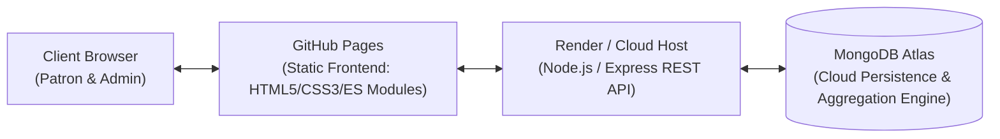

# VÉRRA — Premium Botanical Hair Care & Business Intelligence Platform

[](https://jackso1328.github.io/verra-dashboard/)
[](https://nodejs.org/)
[](https://www.mongodb.com/cloud/atlas)
[](https://www.chartjs.org/)
[](https://github.com/jackso1328/verra-dashboard)
[](LICENSE)

An international luxury botanical hair-care e-commerce storefront and executive **Business Intelligence (BI) analytics platform** priced in Indian Rupee (INR / ₹). 

Built as a full-stack **Academic Business Intelligence Final Project** combining luxury editorial beauty UI/UX, responsive customer shopping workflows, authoritative server-side order calculation, role-based JWT security, and **MongoDB Atlas cloud database aggregation analytics**.

---

## 📌 Table of Contents
1. [Cloud Architecture & Workflow](#-cloud-architecture--workflow)
2. [Live Links & Demo Access](#-live-links--demo-access)
3. [Business Intelligence Dashboard Modules](#-business-intelligence-dashboard-modules)
4. [Key BI Metrics & Formulas](#-key-bi-metrics--formulas)
5. [Product Catalog & Unit Economics](#-product-catalog--unit-economics)
6. [Cloud Deployment Guide](#-cloud-deployment-guide)
   - [Deploy Frontend to GitHub Pages](#1-deploy-frontend-to-github-pages)
   - [Deploy Backend to Render (Free Cloud)](#2-deploy-backend-to-render-free-cloud)
   - [Connecting Frontend to Cloud Backend](#3-connecting-frontend-to-cloud-backend)
7. [Local Development Setup](#-local-development-setup)
8. [Database Seeding & Pre-Configured Accounts](#-database-seeding--pre-configured-accounts)
9. [REST API Reference](#-rest-api-reference)
10. [Automated Testing](#-automated-testing)

---

## ☁️ Cloud Architecture & Workflow

The platform satisfies cloud-native BI system requirements by separating the client-side presentation layer, cloud API orchestration, and cloud analytical storage:



* **Client Presentation Layer**: Hosted on **GitHub Pages** (`https://jackso1328.github.io/verra-dashboard/`). Pure static HTML5, CSS3 variables, and vanilla ES modules with interactive Chart.js visualizations.
* **Application & Analytics Layer**: Hosted on **Render.com** (or any Node.js cloud provider). Enforces JWT role-based access control, server-side order verification, and executes analytical aggregation pipelines.
* **Cloud Database Layer**: Hosted on **MongoDB Atlas** (M0 Free Cloud Cluster). Holds 180+ synthetic historical orders across a 12-month period, audited inventory movements, patron profiles, and operating expenses.

---

## 🔗 Live Links & Demo Access

| Component | URL | Notes |
| :--- | :--- | :--- |
| **Frontend Storefront & BI Portal** | [jackso1328.github.io/verra-dashboard](https://jackso1328.github.io/verra-dashboard/) | Live on GitHub Pages |
| **Cloud API Health Check** | `https://<your-backend>.onrender.com/api/health` | Verifies cloud database connectivity |
| **Administrative BI Portal** | [Access BI Admin Portal](https://jackso1328.github.io/verra-dashboard/admin/index.html) | Requires Administrator authentication |

### Pre-Configured Credentials

| Role | Email | Password | Permissions |
| :--- | :--- | :--- | :--- |
| **Administrator** | `admin@verra.com` | `VerraAdmin2026!` | Access to all 7 BI dashboard views, expense logging, restocking, and raw CSV ledger exports. |
| **Patron / Customer** | `priya.sharma@example.com` | `Ritual2026!` | Storefront shopping, real-time bag, server-verified checkout, order history receipts. |

---

## 📊 Business Intelligence Dashboard Modules

The VÉRRA Administrative BI suite provides **7 specialized dashboards** designed for operational monitoring and executive decision-making:

1. **Executive Overview (`/admin/index.html`)**:
   * **12 KPI Cards** comparing the current active period against the equivalent prior period with trend indicators (▲ / ▼).
   * Interactive revenue trend line and Gross Profit breakdown.
2. **Sales Analytics (`/admin/sales.html`)**:
   * Multi-period timeline filtering (7d, 30d, 90d, 12m, Custom Date Range).
   * Channel distribution: Direct Online vs. Flagship Salons vs. Partner Boutiques.
   * Regional distribution: Performance across major Indian metropolitan markets (Mumbai, Delhi NCR, Bengaluru, Hyderabad, Chennai, Kolkata, Pune).
3. **Product Performance Matrix (`/admin/products.html`)**:
   * Granular SKU breakdown: Units sold, gross sales, COGS, gross profit, and margin %.
   * Visual gross profit contribution share and average selling price (ASP) tracking.
4. **Statement of Financial Profit & Loss (`/admin/finance.html`)**:
   * Audited P&L waterfall: Net Revenue $\rightarrow$ COGS $\rightarrow$ Gross Profit $\rightarrow$ Operating Expenses (OpEx) $\rightarrow$ Net Operating Profit.
   * Interactive OpEx logger categorized by Marketing, Packaging, Carrier Logistics, Salaries, and Operations.
5. **Inventory Intelligence & Stock Valuation (`/admin/inventory.html`)**:
   * Total warehouse stock valuation in INR (₹).
   * Low-stock warnings and run-rate depletion runway (days of inventory remaining).
   * Stock adjustment modal generating traceable inventory movement logs.
6. **Customer Analytics & RFM Cohorts (`/admin/customers.html`)**:
   * Recency, Frequency, and Monetary (RFM) patron segmentation: *VIP Champions*, *Loyal Patrons*, *Recent First-Time*, and *At-Risk / Dormant*.
   * Average Customer Lifetime Value (LTV) and repeat purchase rate analysis.
7. **Audit Ledger & Multi-Dataset Reports (`/admin/reports.html`)**:
   * Filterable raw transaction table with live status updates.
   * **Instant CSV Export** for offline spreadsheet analysis and audit compliance.

---

## 📐 Key BI Metrics & Formulas

Every metric displayed on the dashboard is derived using authoritative financial accounting principles:

| Metric | Mathematical Formula | BI & Business Significance |
| :--- | :--- | :--- |
| **Gross Sales** | $\sum (\text{Unit Retail Price} \times \text{Qty Sold})$ | Total retail demand generated before discounts. |
| **Net Revenue** | $\text{Gross Sales} - \text{Discounts}$ | Realized operational cash turnover (excludes cancelled/refunded orders). |
| **COGS** | $\sum (\text{Unit Production Cost} \times \text{Qty Sold})$ | Direct raw material & packaging costs snapshotted at time of sale. |
| **Gross Profit** | $\text{Net Revenue} - \text{COGS}$ | Funds remaining to cover operating overhead and R&D. |
| **Gross Margin %** | $\left(\frac{\text{Gross Profit}}{\text{Net Revenue}}\right) \times 100$ | Pricing power efficiency benchmarked at **~70%–73%** for luxury formulations. |
| **Operating Expenses (OpEx)** | $\sum (\text{Marketing} + \text{Packaging} + \text{Shipping} + \text{Salaries} + \text{Ops})$ | Total operational overhead incurred during the analysis window. |
| **Net Operating Profit** | $\text{Gross Profit} - \text{OpEx}$ | Operating profitability before corporate tax. |
| **Average Order Value (AOV)** | $\frac{\text{Net Revenue}}{\text{Qualifying Order Count}}$ | Average basket spend in INR (₹). |
| **Repeat Purchase Rate** | $\left(\frac{\text{Customers with } \ge 2\text{ Orders}}{\text{Total Unique Customers}}\right) \times 100$ | Customer loyalty and formulation satisfaction retention metric. |
| **Inventory Valuation** | $\sum (\text{Stock on Hand} \times \text{Unit Cost})$ | Total enterprise working capital held in warehouse storage. |

---

## 🌿 Product Catalog & Unit Economics

| Formulation | Ritual Category | Size | Retail Price | Unit COGS | Gross Margin | Active Ingredients |
| :--- | :--- | :---: | :---: | :---: | :---: | :--- |
| **Root Revival Oil** | Scalp Rituals | 50 ml | ₹1,299 | ₹380 | **70.7%** | Mediterranean Rosemary, Cold-Pressed Jojoba, Peppermint Leaf |
| **Silk Elixir** | Smoothing Rituals | 50 ml | ₹1,599 | ₹460 | **71.2%** | Virgin Moroccan Argan, Camellia Japonica, Evening Primrose |
| **Botanical Nourish Oil** | Restorative Rituals | 100 ml | ₹1,099 | ₹320 | **70.9%** | Sun-Dried Amla Berry, Bhringraj, Black Sesame, Sweet Almond |
| **Coco Silk Treatment** | Pre-Wash Rituals | 100 ml | ₹899 | ₹240 | **73.3%** | Virgin Cold-Pressed Coconut, Marula Oil, Avocado |

---

## 🚀 Cloud Deployment Guide

### 1. Deploy Frontend to GitHub Pages

The repository includes a ready-to-run GitHub Actions workflow (`.github/workflows/deploy.yml`):

1. In your GitHub repository, open **Settings > Pages**.
2. Under **Build and deployment > Source**, select **GitHub Actions**.
3. Push to `main` (or trigger the workflow manually under the **Actions** tab).
4. GitHub Pages will publish your frontend at:
   ```
   https://<your-username>.github.io/verra-dashboard/
   ```

*(All assets, CSS, and JS links use relative paths, ensuring complete immunity from GitHub Pages subpath 404 errors).*

---

### 2. Deploy Backend to Render (Free Cloud)

Deploy the backend to **Render.com** in 2 minutes using the included `render.yaml` blueprint:

1. Sign in to [Render.com](https://render.com) using your GitHub account.
2. Click **New + > Web Service** and link your `jackso1328/verra-dashboard` repository.
3. Configure the service:
   * **Root Directory**: `backend`
   * **Runtime**: `Node`
   * **Build Command**: `npm install`
   * **Start Command**: `npm start`
4. Add the **Environment Variables**:
   * `NODE_ENV` = `production`
   * `PORT` = `5000`
   * `MONGODB_URI` = `<Your MongoDB Atlas Connection String>`
   * `DB_NAME` = `verra_bi`
   * `JWT_SECRET` = `verra_luxury_secret_jwt_key_2026_botanical`
   * `FRONTEND_ORIGIN` = `*`
5. Click **Create Web Service**. Render will build and provide a public URL:
   `https://<your-service-name>.onrender.com`

---

### 3. Connecting Frontend to Cloud Backend

The frontend dynamically discovers your cloud backend without code rebuilds:

* **Method A (Browser Console)**:
  Open your deployed GitHub Pages site, press `F12` to open the DevTools Console, and run:
  ```javascript
  setVerraApiUrl('https://<your-service-name>.onrender.com/api');
  ```
* **Method B (Prompt Dialog)**:
  Run `setVerraApiUrl()` in the console without arguments to open a graphical prompt.
* **Method C (Code Default)**:
  Or set `API_BASE_URL` in [`frontend/js/api.js`](frontend/js/api.js) to your production backend URL.

---

## 💻 Local Development Setup

### Prerequisites
* [Node.js](https://nodejs.org/) (v18.0.0 or higher)
* [MongoDB](https://www.mongodb.com/) (Local installation or MongoDB Atlas cloud cluster)

### 1. Backend Setup
```bash
cd backend
npm install
cp .env.example .env
```

Configure `backend/.env`:
```ini
PORT=5000
NODE_ENV=development
MONGODB_URI=mongodb://127.0.0.1:27017/verra_bi
DB_NAME=verra_bi
JWT_SECRET=verra_luxury_secret_jwt_key_2026_botanical
FRONTEND_ORIGIN=*
```

Start the backend:
```bash
npm run dev
```

Verify backend health at: `http://localhost:5000/api/health`

### 2. Frontend Setup
From the repository root directory, serve the static frontend with any local HTTP server:
```bash
# Using Python:
python -m http.server 3000 --directory frontend

# Or using Node http-server:
npx http-server frontend -p 3000
```
Open `http://localhost:3000` in your web browser.

---

## 🌱 Database Seeding & Pre-Configured Accounts

To populate your database with 180+ synthetic historical orders across a 12-month period, inventory audit logs, customer cohorts, and operating expenses:

```bash
cd backend
npm run seed
```

The seeder connects to your configured `MONGODB_URI` and creates:
* 4 botanical hair care formulations with realistic high-resolution imagery.
* 180 synthetic historical orders distributed across 7 Indian regions and 3 sales channels.
* Traceable warehouse inventory stock movement logs.
* Categorized operational expenses (Marketing, Carrier, Packaging, Payroll).
* Pre-seeded Administrator (`admin@verra.com`) and Customer (`priya.sharma@example.com`) accounts.

---

## 📡 REST API Reference

### Public Endpoints
* `GET /api/health` — Service health & live MongoDB Atlas cluster connection status.
* `GET /api/products` — Filterable product catalog (`category`, `search`, `sort`).
* `GET /api/products/:id` — Single formulation details with client reviews.

### Authentication Endpoints
* `POST /api/auth/register` — Register patron account (role locked to `customer`).
* `POST /api/auth/login` — Authenticate and receive JWT access token.
* `POST /api/auth/logout` — Clear session cookies/tokens.
* `GET /api/auth/me` — Current authenticated user profile *(Bearer JWT required)*.

### Patron Order Processing
* `POST /api/orders` — Submit demonstration checkout order *(Server recalculates pricing, GST, and decrements inventory)*.
* `GET /api/orders/my-orders` — Patron order history receipts *(Bearer JWT required)*.
* `GET /api/orders/my-orders/:id` — Individual order receipt detail.

### Administrative Business Intelligence *(Role: `admin` required)*
* `GET /api/admin/overview` — 12 Executive KPIs and comparison against previous period.
* `GET /api/admin/sales-trend` — Time series timeline, sales channels, and geographical regions.
* `GET /api/admin/product-performance` — Product comparative matrix, ASP, and margin %.
* `GET /api/admin/financials` — Statement of Profit & Loss and OpEx categorization.
* `GET /api/admin/inventory` — Stock levels, valuation, low-stock warnings, and audit logs.
* `GET /api/admin/customers` — Repeat purchase rates and RFM cohort segmentation.
* `GET /api/admin/reports/sales` — Order ledger records & instant CSV export (`?format=csv`).
* `POST /api/admin/expenses` — Record an operational expense into P&L.
* `PATCH /api/admin/products/:id` — Update stock levels or product details.
* `PATCH /api/admin/orders/:id/status` — Modify order status (*processing, shipped, delivered, refunded*).

---

## 🧪 Automated Testing

The platform includes automated unit and integration tests using Node.js's native test runner (`node --test`):

```bash
cd backend
npm test
```

### Verified Test Assertions (10/10 Passing):
1. **Executive KPIs**: Product filter isolates product line items and allocates order discounts proportionally.
2. **Product Profitability**: Product-level net sales and profit reconcile with brand totals.
3. **Customer Analytics**: Calculates genuine Recency, Frequency, Monetary spend and excludes invalid orders.
4. **Sales Forecasting**: Produces a continuous 12-month series including zero-sales months.
5. **Inventory Intelligence**: Runway accurately indicates null/"No recent sales" when run-rate is zero.
6. **Checkout Accounting**: Reconciles subtotal, discount, 5% GST (inclusive), and shipping tier.
7. **Stock Deductions**: Aggregates duplicate product lines and rejects preview/invalid IDs.
8. **Review Verification**: Authorizes Verified Purchase badge only when matching qualifying order exists.
9. **BI Date Range**: Accurately computes previous equivalent period duration.
10. **Order Filter Generator**: Handles both ObjectIds and SKUs defensively.

---

## 📄 License

This academic project is open-source and released under the [ISC License](LICENSE).
